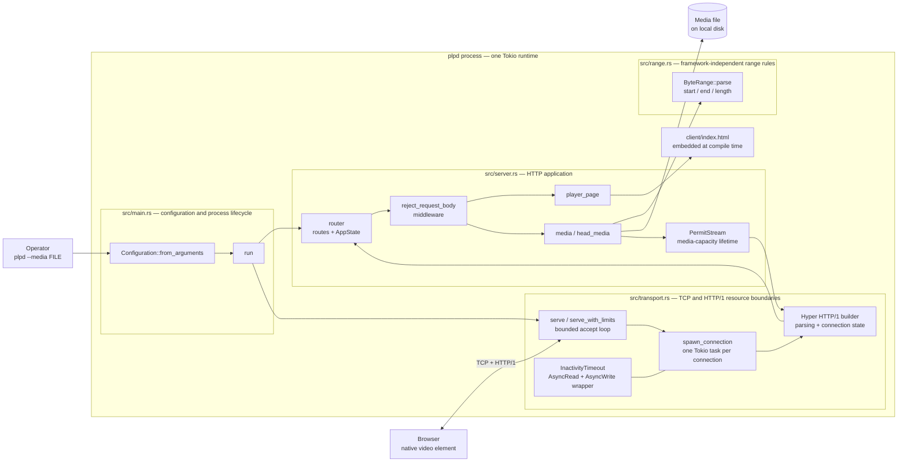
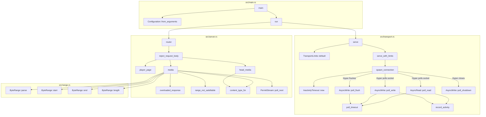
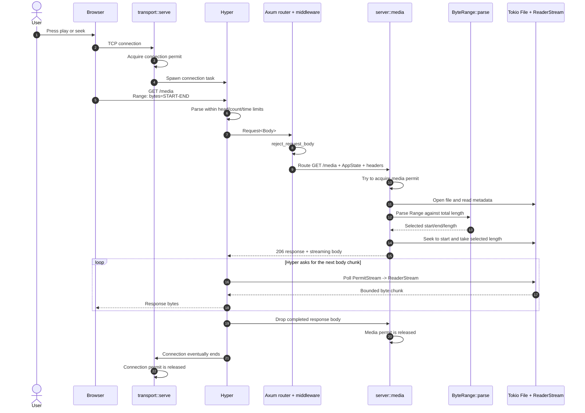

# Current Architecture and Implementation Walkthrough

This document describes the code that exists today: how the process starts, how
the transport and application layers fit together, how a media request becomes
file bytes on a socket, and where each resource limit is held.

It is intentionally about the current implementation. The broader product
direction lives in [the platform specification](private-library-platform-spec.md),
and the order of future work lives in [the roadmap](roadmap.md).

## Current scope

The daemon serves one operator-selected media file and one embedded browser
player. It supports:

- `GET /` for the browser player;
- `GET /media` for the complete file or one byte range;
- `HEAD /media` for full-file metadata without a response body;
- bounded HTTP/1 connections, request heads, header fields, header-read time,
  transport inactivity, and active media bodies.

It does not yet contain a library catalogue, object IDs, uploads, users,
authorization, replication, discovery, encryption, or multiple quality levels.

## The architecture at a glance



The important boundary is between `transport.rs` and `server.rs`:

- **Transport** decides whether a connection may exist and safely turns socket
  bytes into HTTP requests.
- **Server/application** decides which route runs and what HTTP response it
  produces.
- **Range/domain** decides what a byte-range string means without knowing about
  sockets, Axum, Hyper, Tokio, or files.

## Production function map

This diagram lists every production function or method implemented in the Rust
source and shows the most important calls between them.



The arrows are calls or runtime delegation, not ownership. For example, `media`
constructs a `PermitStream`, but Hyper later calls `PermitStream::poll_next`
while it is sending the response body.

## File and type responsibilities

| File or type | Owns | Does not own |
| --- | --- | --- |
| `src/main.rs` | CLI parsing, validation, bind address, process exit behavior, startup wiring. | HTTP parsing, routing rules, streaming details. |
| `Configuration` | The selected media path and socket address. | Runtime state shared by handlers. |
| `src/transport.rs` | Accept loop, connection tasks, Hyper configuration, connection permits, inactivity tracking. | Route selection and media semantics. |
| `TransportLimits` | The five transport-level limit values. | Active media-body capacity. |
| `InactivityTimeout<T>` | Resets a deadline when socket reads or writes make progress. | A maximum duration for a legitimate active stream. |
| `src/server.rs` | Axum routes, middleware, application state, media responses, content type, media-body permits. | TCP accept behavior and HTTP parsing. |
| `AppState` | An `Arc` to the media path and an `Arc` to the media semaphore. | Per-request calculated values such as file length or selected range. |
| `PermitStream<S>` | Holds a media permit for exactly as long as a response body can still be streamed. | Reading the file itself; its inner `ReaderStream` does that. |
| `src/range.rs` | Parsing and validating one RFC-style byte range against a known representation length. | HTTP response construction or file I/O. |
| `client/index.html` | A diagnostic browser UI and native `<video src="/media">` element. | Media decoding, range selection, or a separate frontend build. |
| `tests/media_streaming.rs` | Executable-level behavior over real TCP sockets. | Internal implementation details. |

## Startup: from command line to listening socket

Given:

```powershell
cargo run -- --media "C:\videos\example.mp4" --bind 127.0.0.1:8080
```

the startup path is:

1. `#[tokio::main]` creates the Tokio runtime and enters `main`.
2. `Configuration::from_arguments` reads `--media` and `--bind`, validates the
   address, and verifies that the media path points to a file.
3. `run` binds a Tokio `TcpListener`.
4. `server::router` builds the Axum router and creates one shared `AppState`.
5. `transport::serve` applies the default transport limits and enters the
   accept loop.

The process uses asynchronous tasks rather than one operating-system thread per
connection. Tokio schedules those tasks on its multi-thread runtime. A task that
is waiting for the network or filesystem yields so runtime threads can do other
work.

## Connection lifecycle and its limits

`serve_with_limits` creates a semaphore containing 64 connection permits. The
loop acquires a permit **before** calling `accept`:

```text
acquire connection permit -> accept socket -> spawn connection task
                                      permit moves into task -------^
```

At 64 active connections, the application stops accepting. Pending connection
attempts remain subject to the operating system's bounded listen queue rather
than becoming an unbounded collection of application tasks.

`spawn_connection` then:

1. adapts the Axum `Router` from a Tower service into a Hyper service;
2. configures Hyper's HTTP/1 parser;
3. wraps the `TcpStream` in `InactivityTimeout` and `TokioIo`;
4. starts `serve_connection` in a Tokio task;
5. retains the connection permit until `serve_connection` ends.

The current transport limits are:

| Limit | Value | Enforcement point | Result when exceeded |
| --- | ---: | --- | --- |
| Active TCP connections | 64 | Connection semaphore before `accept`. | New connections wait outside the application accept loop. |
| Request-head bytes | 16 KiB | Hyper HTTP/1 builder. | Hyper returns `431 Request Header Fields Too Large`. |
| Header fields | 64 | Hyper HTTP/1 builder. | Hyper returns `431 Request Header Fields Too Large`. |
| Time to finish request headers | 10 seconds | Hyper timer. | The incomplete connection is closed. |
| Transport inactivity | 30 seconds | `InactivityTimeout` around the socket. | The inactive connection is closed. |

The inactivity limit is not a 30-second video limit. Every successful socket
read or write resets the deadline. A two-hour stream remains valid as long as it
continues making I/O progress.

## Request routing

Once Hyper has parsed a request, `TowerToHyperService` passes it to the Axum
router. Axum applies `reject_request_body` before selecting a handler.

| Request | Handler or outcome |
| --- | --- |
| `GET /` | `player_page` returns the embedded `client/index.html`. |
| `GET /media` | `media` returns the full file or one selected byte range. |
| `HEAD /media` | `head_media` returns full-file headers and an empty body. |
| Known path with another method | Axum returns `405 Method Not Allowed`. |
| Unknown path | Axum returns `404 Not Found`. |
| Request with a non-zero/invalid `Content-Length` or any `Transfer-Encoding` | Middleware returns `413 Payload Too Large` and `Connection: close`. |

The daemon currently has no endpoint that needs a request body. Rejecting bodies
at one middleware boundary prevents the server from accepting uploads or
buffering body data accidentally before an upload design exists.

## A media request in action

The following sequence is the complete happy path for a browser range request.



There are two independent permits in this sequence:

- The **connection permit** lives in the spawned Hyper connection task. It
  limits sockets, including idle keep-alive sockets.
- The **media permit** lives inside `PermitStream`. It limits response bodies
  that can still produce media bytes, not merely the short handler call that
  created the response.

If the media permit were a local variable in `media`, it would be dropped as
soon as the handler returned the `Response`. That would fail to limit streaming,
because Hyper sends the body after the handler returns. Moving the permit into
the body ties its lifetime to the resource it protects.

## What `media` does

`media` performs these steps:

1. Try to acquire one of 16 media-stream permits. If none is available, return
   `503 Service Unavailable`, an empty body, and `Retry-After: 1`.
2. Open the configured file with `tokio::fs::File` and read its length.
3. Read the optional `Range` header.
4. Ask `ByteRange::parse` to classify the range.
5. For a selected range, seek to its first byte and prepare `206 Partial
   Content` headers. Without a selected range, prepare a `200 OK` full-file
   response.
6. Wrap `file.take(content_length)` in `ReaderStream`.
7. Wrap that stream in `PermitStream` and then in Axum's `Body`.
8. Return the response object. Hyper consumes its body later.

`AsyncReadExt::take` is the byte boundary. Once the selected number of bytes has
been read, the wrapper reports end-of-file to `ReaderStream`, even though the
underlying file contains more data. `ReaderStream` then ends the HTTP body. The
whole video is never loaded into memory.

## Range behavior

`ByteRange::parse(value, total_length)` has three outcomes:

- `Selected(ByteRange)` — serve the chosen inclusive range;
- `UnsupportedUnit` — ignore the range and serve the full representation;
- `Invalid` — return `416 Range Not Satisfiable`.

Examples for an 11-byte file:

| Header | Selected bytes | Length | HTTP result |
| --- | --- | ---: | --- |
| no `Range` | `0-10` | 11 | `200 OK` |
| `bytes=2-5` | `2-5` | 4 | `206 Partial Content` |
| `bytes=6-` | `6-10` | 5 | `206 Partial Content` |
| `bytes=-5` | `6-10` | 5 | `206 Partial Content` |
| `bytes=6-999` | `6-10` | 5 | `206 Partial Content` |
| `items=0-1` | full file | 11 | `200 OK`; unsupported unit is ignored |
| `bytes=8-2` | none | 0 | `416 Range Not Satisfiable` |
| `bytes=0-1,4-5` | none | 0 | `416`; multiple ranges are unsupported |

The endpoints are inclusive, so `length = end - start + 1`.

`HEAD /media` intentionally describes the complete representation and sends no
body. It does not acquire a media permit and currently ignores `Range`.

## Browser behavior

`client/index.html` is compiled into the binary through:

```rust
include_str!("../client/index.html")
```

The important browser element is:

```html
<video controls preload="metadata" src="/media">
```

The browser decides when to make `GET /media` requests and which ranges it
needs. The HTML client does not read the media file or call a Rust function
directly; `/media` is a URL resolved against the same server that returned the
page.

## Framework responsibilities

| Component | Responsibility in this codebase |
| --- | --- |
| Tokio | Async runtime, TCP listener/stream, filesystem I/O, tasks, semaphores, timers. |
| Hyper | HTTP/1 parsing, request/response connection state, polling response bodies. |
| `hyper-util` | Adapts Tokio I/O to Hyper and the Tower/Axum router to a Hyper service. |
| Axum | Routes, state extraction, header extraction, middleware, response bodies. |
| Tower | The common `Service` interface and request-body type mapping used by the adapter. |
| `tokio-util` | Converts the async file reader into a stream of byte chunks. |
| `futures-core` | Supplies the `Stream` trait implemented by `PermitStream`. |

Axum remains the application framework even though `transport.rs` invokes Hyper
directly. The project uses Hyper's connection builder because the resource
budget requires parser-level limits that `axum::serve` does not expose.

## Tests and what they prove

There are two complementary levels of tests:

- Module tests call the Axum router or transport helpers directly. They isolate
  range semantics, handlers, response-body permit lifetime, timeouts, and
  connection backpressure.
- `tests/media_streaming.rs` starts the compiled executable and sends real
  HTTP/1 bytes over TCP. These tests prove the externally observable contract,
  including malformed requests and Hyper's parser limits.

Run the complete suite with:

```powershell
cargo test
```

The current suite contains 28 tests: 16 module tests and 12 executable-level
TCP tests.

The production source also contains Rustdoc comments for its modules, types,
fields, and functions. Rust Analyzer displays these comments while hovering over
symbols in an editor. To generate the complete private-item documentation:

```powershell
cargo doc --no-deps --document-private-items --open
```

## How to read the code

For a first pass, follow this order:

1. `src/main.rs` — see how configuration creates the router and listener.
2. `src/server.rs::router` — see the route table and shared state.
3. `src/server.rs::media` — see how an HTTP range becomes a bounded body.
4. `src/range.rs` — see the pure range rules.
5. `src/transport.rs::serve_with_limits` and `spawn_connection` — see how
   connections are bounded and handed to Hyper.
6. `src/transport.rs::InactivityTimeout` — see how socket activity controls the
   deadline.
7. `tests/media_streaming.rs` — see the behavior from a client's perspective.

## Known boundaries of this slice

- One process serves exactly one configured local file.
- The file is identified by the fixed `/media` route, not a content ID.
- MIME type comes from a small extension match rather than content inspection.
- Only one byte range is supported per request.
- There is no graceful shutdown path yet.
- Transport errors end their connection but are not yet emitted as structured
  diagnostics.
- Limits are compile-time constants/defaults rather than operator configuration.
- This server is still a local foundation, not an Internet-facing sharing node.

These boundaries are deliberate. Future work should change them one vertical
slice at a time and update this document whenever the runtime path changes.
